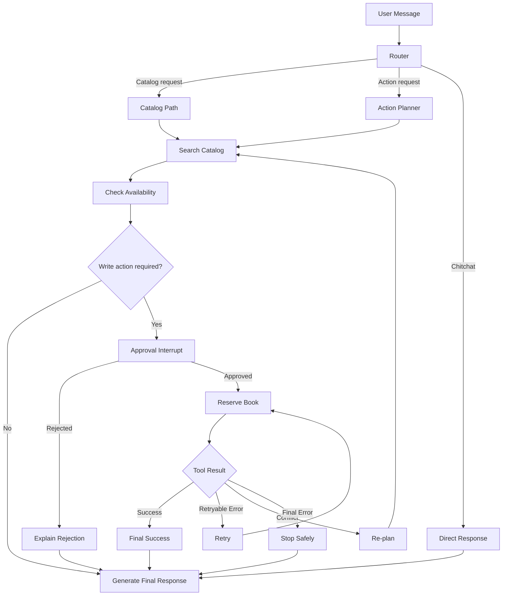
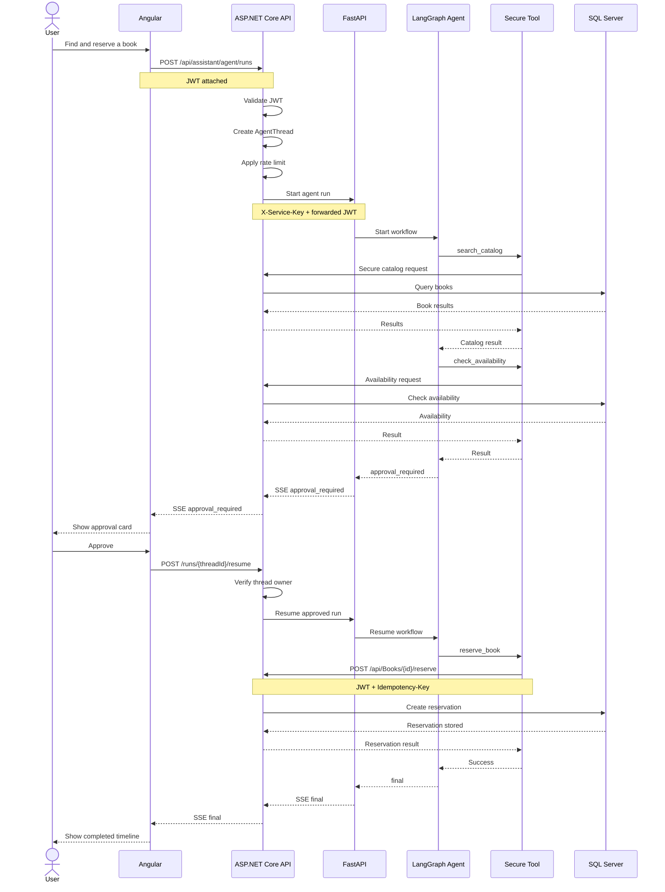

# Week 7 Project — Library Agent: Find, Approve, Reserve

## Overview

The Week 7 Library Agent extends the existing Library Management System with a secure AI-assisted workflow.

The agent can:

- search the library catalog
- check book availability
- ask the user for approval before a write operation
- reserve a book
- list the current user's reservations
- recover from retryable failures
- re-plan when a reservation conflicts
- persist agent state
- resume after human approval
- enforce thread ownership
- reject unauthorized access
- stream typed events to the Angular frontend
- survive deterministic tests and CI checks

The final system combines:

- Angular frontend
- ASP.NET Core backend
- SQL Server
- Python / FastAPI AI service
- LangGraph orchestration
- Ollama / language-model integration
- pytest
- xUnit
- GitHub Actions

---

# Project Structure

```text
Week7-project/
│
├── Backend/
│   └── LibraryAPI2/
│
├── BackendTests/
│
├── Frontend/
│   └── LibraryUI/
│
├── ai-services/
│   ├── main.py
│   ├── agent_api.py
│   └── agent/
│       ├── secure_tools.py
│       ├── router_workflow.py
│       ├── retry_workflow.py
│       ├── main_workflow.py
│       ├── hitl_workflow.py
│       ├── resume_approval.py
│       ├── state_history.py
│       └── reject_approval.py
│
├── tests/
│   └── test_agent_logic.py
│
├── docs/
│
└── README.md
```

---

# Architecture

The system uses a split architecture.

The Angular application communicates only with the ASP.NET Core backend.

The browser does not directly access the Python AI service.

The ASP.NET Core backend:

- authenticates the user
- owns the persistent business data
- checks agent-thread ownership
- applies rate limits
- forwards authorized agent requests
- exposes secure reservation APIs

The FastAPI service:

- hosts the agent-facing API
- validates the shared service key
- orchestrates AI operations
- streams typed events
- communicates with secure tools using the user's forwarded authorization context

---

# LangGraph Workflow

The agent uses routing, tools, retry handling and re-planning.



---

# Full Request Sequence



---

# Agent Tools

The final agent uses the following capabilities.

## `search_catalog`

Searches the library catalog.

This is a read-only operation.

## `check_availability`

Checks whether a selected book is currently available.

This is also read-only.

## `reserve_book`

Creates a persistent reservation.

This is a write operation and therefore requires:

- authenticated user context
- human approval
- valid positive book ID
- idempotency key
- backend authorization

## `list_my_reservations`

Lists reservations belonging only to the authenticated user.

The user ID is derived from authentication rather than accepted from an arbitrary tool argument.

---

# Human-in-the-Loop Approval

Reservation is treated as a high-impact write operation.

The agent does not automatically reserve a book.

Instead:

1. the agent searches for a suitable book
2. availability is checked
3. the workflow pauses
4. an `approval_required` event is sent
5. Angular displays the approval card
6. the user can Approve or Reject
7. the workflow resumes only after the user's decision

The pending approval state is persisted so the interface can recover after browser refresh.

---

# Persistence

Agent state is persisted using checkpointing and backend thread state.

The system uses a `threadId` to identify an agent run.

The `AgentThread` record stores information such as:

- thread ID
- owner user ID
- status
- pending approval
- final answer
- error state
- cancellation state

A foreign user cannot load or resume another user's thread.

---

# Authentication and Authorization

The Angular frontend sends the user's JWT to the ASP.NET Core backend.

The backend derives the user identity from JWT claims.

The user cannot choose another user's ID in the request body.

For agent calls:

```text
Browser
    ↓ JWT
ASP.NET Core
    ↓ X-Service-Key + forwarded JWT
FastAPI
    ↓ authorized tool call
ASP.NET Core secure endpoint
```

The FastAPI service rejects requests that do not provide the configured shared service key.

---

# Typed SSE Events

The agent run API streams typed Server-Sent Events.

Supported event types include:

## `step`

Example:

```json
{
  "kind": "tool_call",
  "name": "search_catalog",
  "summary": "Searching for matching books"
}
```

## `token`

Example:

```json
{
  "text": "I found..."
}
```

## `approval_required`

Example:

```json
{
  "threadId": "example-thread",
  "calls": [
    {
      "name": "reserve_book",
      "args": {
        "book_id": 10
      }
    }
  ]
}
```

## `final`

Example:

```json
{
  "answer": "The book was reserved successfully.",
  "sources": []
}
```

## `error`

Example:

```json
{
  "code": "AGENT_UNAVAILABLE",
  "message": "The agent service is unavailable.",
  "retryable": true
}
```

---

# Error Handling

The agent classifies tool errors into typed outcomes.

## Retryable Error

Examples:

- temporary connection failure
- timeout
- transient dependency failure

Action:

```text
retry
```

## Conflict

Example:

```text
book is no longer available
```

Action:

```text
re-plan
```

The agent can search for another suitable book rather than repeatedly attempting the same failing operation.

## Final Error

Examples:

- unauthorized request
- invalid permanent request
- missing resource

Action:

```text
stop safely
```

---

# Idempotency

Reservation requests use an idempotency key.

If the same approved action is submitted twice using the same idempotency key, the backend does not create duplicate reservations.

This protects against:

- rapid double-clicks
- retries
- network retransmission
- accidental repeated requests

---

# Security Controls

The project uses multiple defensive layers.

## 1. Authentication

Protected backend endpoints require JWT authentication.

## 2. Thread Ownership

AgentThread records belong to a specific authenticated user.

Foreign users receive `404 Not Found`.

## 3. Human Approval

Persistent write operations require explicit approval.

## 4. Input Validation

Tool arguments such as `book_id` are validated.

Invalid identifiers such as zero or negative values are rejected.

## 5. Idempotency

Reservation writes are protected against duplicate execution.

## 6. Service Authentication

The Python agent service requires an `X-Service-Key`.

## 7. Rate Limiting

Agent endpoints apply per-user request limits.

## 8. Untrusted Content Handling

Catalog content is treated as data rather than trusted instructions.

Prompt-injection attempts inside book content must not automatically execute write actions.

## 9. Execution Limits

Agent workflows use bounded execution to prevent uncontrolled loops.

## 10. Cancellation

Active runs can be cancelled and the cancellation signal is propagated to the running operation.

---

# Threat Model

| Threat | Example | Mitigation |
|---|---|---|
| Prompt injection | Book description tells model to reserve automatically | Treat retrieved content as untrusted and keep writes behind approval |
| Cross-user access | User B requests User A's thread | Owner check and `404` |
| Duplicate writes | User double-clicks Approve | Idempotency key + UI disable |
| Unauthorized agent access | Client calls FastAPI directly | Shared `X-Service-Key` |
| Invalid tool arguments | Model provides negative book ID | Pydantic validation |
| Excessive usage | User starts many AI requests | ASP.NET rate limiter |
| Dependency failure | FastAPI stops responding | Error handling, retries/circuit-breaker strategy |
| Infinite agent loop | Agent repeatedly retries | Step/retry limits |
| Secret leakage | Token persisted in checkpoint | Token passed through runtime config only |
| Untrusted output | Retrieved content attempts instruction injection | Content wrapping and output validation |

---

# Red-Team Testing

Seven adversarial attack categories were evaluated.

The security work includes layered mitigations such as:

- untrusted-content wrapping
- input validation
- human approval gates
- execution limits
- secret/output checks
- server-side authorization

The detailed report is available at:

```text
docs/week7-red-team-report.md
```

---

# Automated Tests

## Python

The deterministic Python suite contains at least 15 tests.

Current test areas include:

- retry routing
- conflict re-planning
- final error handling
- successful tool results
- invalid book IDs
- 400 handling
- 401 handling
- 403 handling
- 404 handling
- 409 handling
- connection failure
- timeout handling
- success response
- authorization header forwarding
- idempotency key forwarding

Run:

```powershell
python -m pytest "Week7\Week7-project\tests\test_agent_logic.py" -v
```

Expected:

```text
16 passed
```

---

# .NET Integration Tests

The xUnit suite covers at least eight backend scenarios.

These include:

- reservation without authentication
- reservations list without authentication
- preferences without authentication
- unknown book
- unavailable book
- repeated idempotency key
- cross-user thread access
- repeated reservation using a different key

Run:

```powershell
dotnet test "Week7\Week7-project\BackendTests\BackendTests.csproj"
```

Expected:

```text
8 passed
```

---

# Angular Build

Go to:

```powershell
cd "Week7\Week7-project\Frontend\LibraryUI"
```

Install dependencies:

```powershell
npm install
```

Build:

```powershell
npm run build
```

Run locally:

```powershell
npm start
```

Default frontend:

```text
http://localhost:4200
```

---

# Running the .NET Backend

Go to:

```powershell
cd "Week7\Week7-project\Backend\LibraryAPI2"
```

Set the agent service key:

```powershell
$env:AgentService__ServiceKey="week7-local-agent-secret"
```

Run:

```powershell
dotnet run
```

Typical local URL:

```text
http://localhost:5194
```

Swagger:

```text
http://localhost:5194/swagger
```

---

# Running the Python AI Service

Go to:

```powershell
cd "Week7\Week7-project\ai-services"
```

Set the matching service key:

```powershell
$env:AGENT_SERVICE_KEY="week7-local-agent-secret"
```

Run:

```powershell
uvicorn main:app --reload --port 8000
```

FastAPI documentation:

```text
http://127.0.0.1:8000/docs
```

The service key is supplied through the environment and should never be committed to Git.

---

# Running Ollama

The project uses a local Ollama model for AI experiments.

Example model:

```text
llama3.2:3b
```

Ensure Ollama is running before executing workflows that require the model.

Example:

```powershell
ollama run llama3.2:3b
```

---

# Full Local Startup Order

Start the services in this order.

## Terminal 1 — Ollama

```powershell
ollama serve
```

## Terminal 2 — FastAPI

```powershell
cd "Week7\Week7-project\ai-services"

$env:AGENT_SERVICE_KEY="week7-local-agent-secret"

uvicorn main:app --reload --port 8000
```

## Terminal 3 — ASP.NET Core

```powershell
cd "Week7\Week7-project\Backend\LibraryAPI2"

$env:AgentService__ServiceKey="week7-local-agent-secret"

dotnet run
```

## Terminal 4 — Angular

```powershell
cd "Week7\Week7-project\Frontend\LibraryUI"

npm start
```

Then open:

```text
http://localhost:4200
```

---

# Continuous Integration

The repository uses GitHub Actions.

Workflow:

```text
.github/workflows/ci.yml
```

The CI pipeline contains three jobs:

```text
dotnet
angular
python
```

The pipeline runs on:

- pull requests
- pushes to `main`

Real-LLM evaluation is intentionally excluded from normal CI because it may:

- cost money
- require external services
- require secrets
- introduce non-deterministic failures
- make every pull request unnecessarily slow

Deterministic tests are used instead.

---

# Evaluation

The agent evaluation uses:

```text
10 scenarios × 3 runs
```

The evaluation considers:

- routing correctness
- tool selection
- completion behavior
- latency
- reliability

The evaluation report is available at:

```text
docs/week7-eval-report.md
```

---

# Multi-Agent Experiment

A stretch experiment compared:

- a single agent
- a supervisor with Catalog and Circulation specialist agents

For the current scope, the single-agent architecture is recommended because it requires:

- fewer model calls
- lower latency
- less orchestration complexity

The comparison is documented in:

```text
docs/week7-single-vs-multi-agent.md
```

---

# Ecosystem Comparison

The project also includes short ecosystem studies.

## MCP

```text
docs/week7-mcp-vs-langchain-tools.md
```

This evaluates whether the library tools should eventually be exposed using the Model Context Protocol.

## Semantic Kernel

```text
docs/week7-semantic-kernel-comparison.md
```

This compares the current Python/LangGraph architecture with a possible .NET/Semantic Kernel implementation.

---

# Known Limitations

The Week 7 system still has several limitations.

1. The current project is intended for development and demonstration rather than production deployment.

2. Local AI quality depends on the selected Ollama model and available hardware.

3. Model responses can still be non-deterministic even when the surrounding business logic is deterministic.

4. Prompt injection cannot be eliminated entirely; write actions therefore remain protected by server authorization and human approval.

5. The current rate-limit settings are demonstration values and would need tuning using real traffic measurements.

6. The project has limited observability compared with a production distributed system.

7. A production deployment should use a managed secret store rather than local environment variables alone.

8. Long-running AI workloads would benefit from stronger distributed cancellation and queue management.

9. Evaluation coverage should continue to expand as new agent behaviors are introduced.

10. Remaining residual risks from the Week 7 red-team report should be treated as Week 8 backlog.

---

# Demo Scenarios

## A — Happy Path

Expected:

```text
Find
→ Check
→ Approval
→ Approve
→ Reservation
→ Final timeline
```

Exactly one reservation should be created.

---

## B — Conflict

When reservation returns:

```text
409 Conflict
```

the agent should re-plan rather than repeatedly attempting the same reservation.

---

## C — Rejection

When the user rejects the approval:

- no reservation is created
- the agent responds appropriately

---

## D — Prompt Injection

A malicious or poisoned catalog description must not cause an unapproved write.

---

## E — Dependency Down

If the FastAPI service becomes unavailable:

- the user receives a clear failure
- the request does not hang indefinitely
- failure handling is visible

---

## F — Refresh During Approval

When the browser is refreshed while approval is pending:

- the thread ID is recovered
- thread state is loaded
- the approval card returns

---

## G — Thread Hijack Attempt

User B requesting User A's thread receives:

```text
404 Not Found
```

---

## H — Double Approve

Two rapid approval attempts must result in:

```text
exactly one reservation
```

---

# Final Summary

Week 7 demonstrates a secure AI-assisted business workflow rather than a simple chatbot.

The core design principle is:

> The model may propose actions, but authenticated backend code controls what is actually allowed to happen.

The project combines agent orchestration, human approval, deterministic business rules, persistence, security testing, automated testing, evaluation and CI into a single full-stack system.